<h1 align="center">Guilherme Santos</h1>

  <strong>Desenvolvedor Backend</strong> · Go · APIs REST · PostgreSQL · automações com IA

  <strong>Ciência da Computação na FIAP</strong>, focado em construir aplicações de
  alta performance — do desenho da API até o comportamento sob carga.
    
  Hoje trabalho no desenvolvimento de <strong>sistemas ERP</strong> e na
  <strong>automação de processos com IA</strong>, digitalizando operações que ainda
  dependem de planilha e papel.
    
  Fora do trabalho, meu ambiente é <strong>Arch Linux com Hyprland</strong>

  
  
  
  
  
  
  

  <a href="https://guilhermesc.me"><strong>guilhermesc.me</strong></a> ·
  <a href="https://linkedin.com/in/guilherme-santos-da-costa">LinkedIn</a> ·
  <a href="mailto:guilhermesantos3828@gmail.com">guilhermesantos3828@gmail.com</a>

---

## Projetos

**[mini-rag](https://github.com/Guilherme-AVVO/mini-rag)**: RAG local em Go com Ollama e pgvector, com documentos fictícios, um comando que calcula Recall@k e MRR sozinho e CI no GitHub Actions. É a versão pública do RAG que construí na Metrol, onde o contextual retrieval levou o Recall@5 de 95% para 100%.

**[StockRoute](https://github.com/Guilherme-AVVO/StockRoute)** ([demonstração](https://stockroute.guilhermesc.me)): o sistema lê o pedido em PDF, liga os itens ao catálogo e exige uma foto em cada coleta, então dá para saber quem separou cada item e quando. Node.js, Express, PostgreSQL e React.

**[soyo-argb](https://github.com/Guilherme-AVVO/b550m-soyo-argb)**: engenharia reversa do protocolo USB de LEDs da minha placa-mãe, reescrito em Rust para funcionar no Linux pela linha de comando, por uma janela ou por um serviço do systemd.

---

<picture>
  <source media="(prefers-color-scheme: dark)" srcset="https://raw.githubusercontent.com/Guilherme-AVVO/Guilherme-AVVO/pacman/pacman-contribution-graph-dark.svg">
  <source media="(prefers-color-scheme: light)" srcset="https://raw.githubusercontent.com/Guilherme-AVVO/Guilherme-AVVO/pacman/pacman-contribution-graph.svg">
  
</picture>

---

  
  

